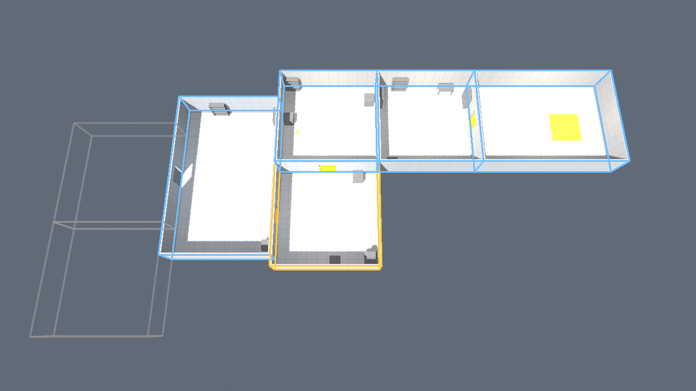

# Watch the Generator Think in Godot 4

Project files for tutorial 07 of the Godot 4 series by Phaix on YouTube (https://www.youtube.com/@Phaix).

Make a procedural level generator in Godot 4 show its work: draw the bounds of every planned room and the markers inside it as 3D lines with an ImmediateMesh, record every room type the generator turned down and flash it in red where it would have stood, plan the same chain one room per key press with a coroutine (and the ticket that stops the old one), and pin a few seeds in a headless check so a change by accident fails loudly. Every step is its own project folder.



## Steps

Every step of the video is its own folder in `steps/`, the exact state at the end of that
part. Open the project in Godot 4.7, then open `steps/<step>/main.tscn` and press F6 to run
that step. The project's main scene is the final step.

| Folder | Part of the video |
|---|---|
| `steps/step_00_start` | Starting point (the final state of the previous tutorial) |
| `steps/step_01_room_bounds` | Step 1 - Lines in 3D |
| `steps/step_02_markers` | Step 2 - A marker is a transform |
| `steps/step_03_rejected` | Step 3 - The generator writes its tests down |
| `steps/step_04_step_through` | Step 4 - One room per key press |
| `steps/step_05_pinned_seeds` | Step 5 - Pin the seeds |

## Controls

WASD or arrow keys or the left stick to walk, mouse or right stick to look, Space to jump,
Esc gives the mouse back, a click captures it again. Further keys per tutorial are shown
in the video and in the HUD.

## Tests

```sh
godot --headless --path . -s res://tests/run_tests.gd
```

## License

Code and scenes: MIT (see LICENSE).
